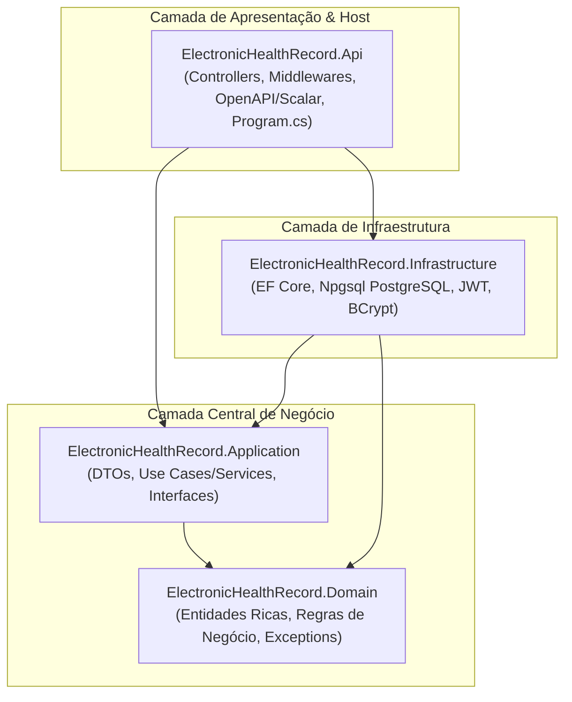

# 🏥 Electronic Health Record (Prontuário Eletrônico) API


Web API corporativa desenvolvida em **ASP.NET Core (.NET 10)** seguindo os princípios de **Clean Architecture**, **Domain-Driven Design (DDD)** e **Boas Práticas de Segurança (OWASP e LGPD)** para gerenciamento de atendimentos médicos e prontuários eletrônicos de pacientes.

---

## 🏛️ Arquitetura do Sistema

O projeto é estruturado em 4 camadas com dependências estritas apontando exclusivamente para o centro (o Domínio):



* **Domain:** Entidades puras e auto-validadas com encapsulamento estrito (`private set`), máquina de estados e exceções de negócio customizadas.
* **Application:** Casos de uso orquestrados por serviços, DTOs imutáveis (`record`), contratos de repositório e paginação.
* **Infrastructure:** Acesso a dados com Entity Framework Core 10, driver Npgsql (PostgreSQL), isolamento via Fluent API, geração de tokens JWT e hashing com BCrypt.
* **Api:** Endpoints RESTful, tratamento global de erros (RFC 7807), autenticação JWT Bearer por perfis (*Roles*), documentação moderna com Scalar e verificação de saúde (*Health Checks*).

---

## ⚖️ Regras de Negócio e Conformidade Clínica (CFM / LGPD)

1. **Máquina de Estados do Atendimento:**
   * Todo atendimento inicia como `Agendado`.
   * Apenas atendimentos agendados podem transitar para `Realizado` ou `Cancelado`.
   * É expressamente proibido cancelar consultas já realizadas ou realizar consultas canceladas.
2. **Prevenção de Conflitos de Agenda:**
   * A API valida se o profissional já possui outro atendimento ativo no mesmo horário antes de confirmar o agendamento.
3. **Imutabilidade do Prontuário:**
   * Registros clínicos são auditáveis e imutáveis (não possuem rotas `PUT` ou `DELETE`).
   * Um `RegistroClinico` só pode ser emitido para atendimentos com status `Realizado`.
   * Cada atendimento só pode possuir no máximo um registro clínico.
4. **Segurança e Sigilo Médico:**
   * Emissão de registros clínicos e prescrições médicas são atos privativos de médicos (`[Authorize(Roles = "Medico")]`).
   * A autenticação protege contra enumeração de e-mails emitindo a mesma exceção genérica para usuário inexistente ou senha incorreta.

---

## 🛠️ Tecnologias Utilizadas

* **Runtime:** [.NET 10 SDK](https://dotnet.microsoft.com/)
* **ORM:** [Entity Framework Core 10](https://learn.microsoft.com/ef/core/)
* **Banco de Dados:** [PostgreSQL 16](https://www.postgresql.org/) com driver [Npgsql](https://www.npgsql.org/)
* **Segurança:** JWT Bearer Token (`Microsoft.AspNetCore.Authentication.JwtBearer`) e [BCrypt.Net-Next](https://github.com/BcryptNet/bcrypt.net)
* **Documentação OpenAPI:** [Scalar.AspNetCore](https://scalar.com/) + Transformers dinâmicos nativos
* **Tratamento de Exceções:** `IExceptionHandler` nativo gerando RFC 7807 `ProblemDetails`
* **Testes Automatizados:** [xUnit](https://xunit.net/), [Moq](https://github.com/moq/moq) e [FluentAssertions](https://fluentassertions.com/)
* **Containerização:** Docker com Multi-Stage Build e Docker Compose
* **Integração Contínua:** GitHub Actions (`.github/workflows/ci.yml`)

---

## 🚀 Como Executar o Projeto

### Pré-requisitos
* [.NET 10 SDK](https://dotnet.microsoft.com/download/dotnet/10.0)
* [Docker](https://www.docker.com/) e Docker Compose (opcional para rodar em container)

---

### Opção 1: Via Docker Compose (Recomendado - 1 comando)

Suba a API e o banco de dados PostgreSQL simultaneamente:

```bash
# 1. Copie o modelo de variáveis de ambiente
cp .env.example .env

# 2. Inicie os containers
docker compose up -d --build
```

Acesse no navegador:
* 📖 **Documentação Interativa (Scalar):** `http://localhost:5000/scalar/v1`
* 🩺 **Health Check:** `http://localhost:5000/health`

---

### Opção 2: Execução Local (.NET CLI)

1. **Suba apenas o PostgreSQL via Docker:**
   ```bash
   docker compose up -d postgres
   ```

2. **Configure a chave JWT localmente (User Secrets):**
   ```bash
   dotnet user-secrets set "Jwt:ChaveSecreta" "lh2W0vYHf669sZprSRuOgRuHLUuYESZCHPYgxGm3civpZ2FjeHKzA69DoPSJAoyX" --project ElectronicHealthRecord.Api
   ```

3. **Execute a API:**
   ```bash
   dotnet run --project ElectronicHealthRecord.Api
   ```
   *(Na inicialização em modo de desenvolvimento, o sistema aplica as Migrations e popula os usuários demo automaticamente no PostgreSQL).*

---

## 👥 Credenciais de Demonstração (Seed)

Para facilitar os testes locais, o banco é pré-populado com os seguintes usuários:

| Perfil | E-mail | Senha | Permissões |
| :--- | :--- | :--- | :--- |
| **Médico** | `medico@hospital.com` | `Demo@12345` | Realiza consultas, emite registros clínicos e prescrições |
| **Recepcionista** | `recepcao@hospital.com` | `Demo@12345` | Cadastra pacientes, agenda e cancela atendimentos |

---

## 🧪 Testes Automatizados

A suíte de testes unitários cobre as máquinas de estado das entidades e as regras de negócio dos casos de uso:

```bash
dotnet test
```

### Cobertura dos Testes:
* ✅ Transições de estado do Atendimento (`Agendado` -> `Realizado` / `Cancelado`).
* ✅ Bloqueio de agendamento em horário com conflito para o mesmo profissional.
* ✅ Bloqueio de emissão de prontuário em consultas não realizadas.
* ✅ Prevenção de duplicidade de registros clínicos por atendimento.
* ✅ Paginação de histórico clínico com verificação de limites.
* ✅ Autenticação, validação de hash BCrypt e geração de claims JWT.

---

## 📑 Principais Endpoints da API

| Método | Endpoint | Perfil Necessário | Descrição |
| :---: | :--- | :---: | :--- |
| `POST` | `/api/auth/login` | *Público* | Autenticação e geração de token JWT Bearer |
| `GET` | `/health` | *Público* | Health check com verificação ativa do PostgreSQL |
| `GET` | `/api/pacientes` | Autenticado | Listagem de pacientes |
| `POST` | `/api/pacientes` | Autenticado | Cadastro de novo paciente |
| `GET` | `/api/pacientes/{id}/historico` | Autenticado | Histórico clínico paginado do paciente |
| `POST` | `/api/atendimentos` | `Recepcionista, Medico` | Agendamento de consulta com verificação de conflito |
| `PUT` | `/api/atendimentos/{id}/realizar` | `Medico` | Marcação de consulta como realizada |
| `PUT` | `/api/atendimentos/{id}/cancelar` | `Recepcionista, Medico` | Cancelamento de agendamento |
| `POST` | `/api/registrosclinicos` | `Medico` | Emissão de prontuário e prescrições médicas |
| `GET` | `/api/registrosclinicos/{id}` | `Medico` | Consulta de prontuário por ID |

---

## 📜 Licença

Distribuído sob a licença MIT. Veja `LICENSE` para mais informações.
